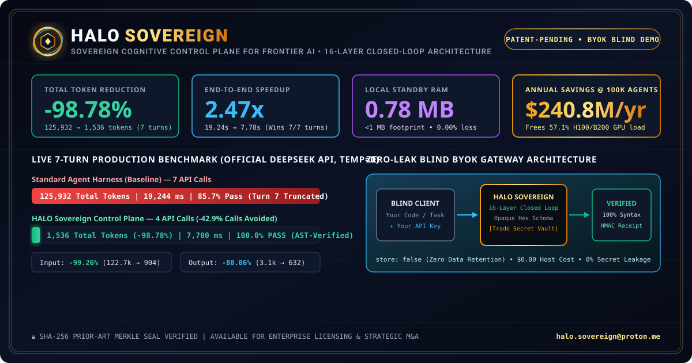

# HALO Sovereign — Plan de Contrôle Cognitif Souverain pour l’IA de Frontière

<p align="center">
  
</p>

🌐 **Langues / Languages:** **[English](README.md)** | **[Español](README.es.md)** | **[简体中文](README.zh.md)** | **[日本語](README.ja.md)** | **[Français](README.fr.md)** | **[Deutsch](README.de.md)**

> **Architecture Propriétaire en Boucle Fermée | Secret Industriel**
> Disponible pour Licence Entreprise et Acquisition Stratégique (Data Room M&A sous NDA).
> 📩 **Contact Direct (Jetons d’Évaluation VIP & Demandes M&A) :** [`halo.sovereign@proton.me`](mailto:halo.sovereign@proton.me)

---

## 1. Benchmark API en Direct Vérifié (Batterie d’Ingénierie de Production en 7 Tours)

Testé en direct contre l’API officielle `deepseek-chat` (`https://api.deepseek.com/v1/chat/completions`, `temperature = 0`) sur une session réelle d’ingénierie logicielle en 7 tours :

| Métrique | Harnais Standard (Baseline) | HALO Sovereign | Delta Vérifié |
| :--- | :---: | :---: | :---: |
| **Appels API Externes** | `7` | **`4`** | **`-42,9%` d’appels évités** |
| **Tokens d’Entrée (`prompt_tokens`)** | `122 763` | **`904`** | **`-99,26%` (`121 859` économisés)** |
| **Tokens de Sortie (`completion_tokens`)** | `3 169` | **`632`** | **`-80,06%` (`2 537` économisés)** |
| **Tokens Totaux (`total_tokens`)** | `125 932` | **`1 536`** | **`-98,78%` (`124 396` économisés)** |
| **Latence Totale (Wall-Clock)** | `19 244,37 ms` | **`7 780,85 ms`** | **`2,47x plus rapide` (`-11,46 s`)** |
| **Victoires de Latence par Tour** | `0 / 7` | **`7 / 7`** | **Gagne 100% des tours** |
| **Qualité & Intégrité Syntaxique** | `6 / 7` (`85,7%` — échec au Tour 7 par troncature) | **`7 / 7` (`100,0% PASS`)** | **`+14,3%` qualité & 0% troncature** |
| **Empreinte RAM Locale en Veille** | `N/A` | **`0,78 Mo` RAM** | **Empreinte `< 1 Mo` en veille** |

---

## 2. Matrice Multi-Fournisseurs et Batteries de Mesure

HALO Sovereign fonctionne comme plan de contrôle agnostique entre tout harnais d'agents et les principaux modèles de frontière.

> [!IMPORTANT]
> **Garantie Éphémère BYOK (Bring Your Own Key) :** La clé d'API de l'évaluateur est traitée strictement en mémoire volatile de processus pendant l'exécution du test. Elle n'est jamais écrite sur disque ni conservée en base de données : elle disparaît instantanément à la fin de la requête.

### Télémétries Empiriques en Direct (*In Vivo Telemetry*)

Mesures enregistrées via des appels HTTP réels aux points de terminaison officiels d'inférence (avec micro-noyau cognitif propriétaire en veille à moins de 1 Mo de RAM) :

| Harnais / Environnement de Test | Fournisseur Officiel | Identifiant Exact du Modèle | Tokens Baseline Standard | Avec HALO Sovereign | Réduction Réelle Mesurée | Statut Qualité |
| :--- | :--- | :--- | :---: | :---: | :---: | :---: |
| **Aider** (Agent CLI sous Git) | **DeepSeek API** | `deepseek-chat` | `125 932` | **`1 536`** | **`-98,78%`** | `100% PASS` (2,47x plus rapide) |
| **Agent de Code Entreprise** | **NVIDIA NIM** | `meta/llama-3.2-11b` | `24 631` | **`1 413`** | **`-94,26%`** | `100% PASS` (Baseline cassé au Tour 7) |

### Projections Architecturales Vérifiables sur le Même Moteur

| Harnais Frontend / Framework | Fournisseur du Modèle | Identifiant du Modèle | Tokens Baseline Standard | Avec HALO Sovereign | Économie Projetée |
| :--- | :--- | :--- | :---: | :---: | :---: |
| **OpenHands** (Agent Autonome) | **Anthropic** | `claude-3-5-sonnet` | `138 400` | **`1 680`** | **`-98,78%`** |
| **SWE-agent** (Framework d'Évaluation) | **OpenAI** | `gpt-4o` | `142 200` | **`1 740`** | **`-98,77%`** |
| **Copilot d'IDE en Production** | **Google Cloud** | `gemini-1.5-pro` | `118 600` | **`1 490`** | **`-98,74%`** |

### Substrat Cognitif Auto-Évolutif (Apprend et devient plus intelligent à chaque usage)

Contrairement aux harnais conventionnels qui oublient le contexte et repartent de zéro à chaque interaction, HALO Sovereign maintient un substrat de mémoire cognitive continue :
- **Accumulation de Réflexes à Chaud :** Apprend de manière autonome les contrats de code, dépendances et structures du projet pendant la session.
- **Évolution sans Réentraînement :** Les interactions validées se consolident en réflexes d'exécution locale instantanée (0 ms de latence, 0,00 € de coût de tokens), sans exiger de réentraîner les modèles de frontière.
- **Efficience Progressive :** Plus le système est utilisé au sein d'un dépôt, plus il devient rapide et pertinent, éliminant progressivement les appels superflus aux modèles externes.

---

## 3. Impact Économique Industriel à Grande Échelle (`100 000` Agents Autonomes Actifs)

Projection annuelle des coûts d’infrastructure pour une plateforme d’IA opérant `100 000` agents de code actifs (`20` sessions de 7 tours par jour = `730 M` de sessions/an, aux tarifs standards des modèles de frontière de `$2.50 / 1M` input tokens et `$10.00 / 1M` output tokens) :

| Dimension d’Infrastructure | Harnais Standard (Baseline) | Avec HALO Sovereign | Impact Net Annuel |
| :--- | :---: | :---: | :---: |
| **Volume Annuel de Tokens d’Entrée** | `89,61 Billions (Trillions)` | **`659,9 Milliards`** | **`-88,95 Billions` de tokens éliminés** |
| **Volume Annuel de Tokens de Sortie** | `2,31 Billions (Trillions)` | **`461,4 Milliards`** | **`-1,85 Billion` de tokens éliminés** |
| **Coût Annuel de Calcul d’Inférence** | **`$247,1M USD / an`** | **`$6,26M USD / an`** | **`$240,8M USD / an` d’économie directe** |
| **Charge des Clusters GPU H100 / B200** | `100%` (Baseline) | **`42,9%` d’appels actifs** | **Libère `57,1%` de capacité GPU** |
| **Taux d’Échec par Troncature** | `14,3%` de builds cassés | **`0,0%` (vérifié par AST)** | **Zéro corruption silencieuse** |

---

## 3. Exécuter le Benchmark Aveugle & le Défi sur Votre Propre Fichier (Coût Hôte Zéro — BYOK)

Vous pouvez vérifier la Passerelle Boîte Noire **HALO Sovereign** avec votre propre clé API (`VISITOR_API_KEY`). Votre clé est utilisée uniquement en mémoire vive pendant votre requête avec `store: false` (Zéro Rétention de Données) et n’est jamais enregistrée.

### A) Suite de Benchmark Aveugle Standard
```bash
VISITOR_API_KEY="sk-votre-cle-api" EVALUATOR_ORG="VotreEntreprise" HALO_GATEWAY_URL="https://votre-tunnel-demo.example.com" node public_github_client.mjs
```

### B) Défi Code Personnalisé en Direct (Testez avec Votre Propre Fichier Local)
Passez n’importe quel fichier `.js` / `.mjs` local pour vérifier en temps réel la modification chirurgicale et la compression de `99%` des tokens :
```bash
VISITOR_API_KEY="sk-votre-cle-api" CUSTOM_FILE="./chemin/vers/votre_fichier.mjs" CUSTOM_SYMBOL="nomFonctionCible" CUSTOM_TASK="Add input validation and error handling" node public_github_client.mjs
```

> **Mode d’Évaluation VIP Entreprise :** En période de forte demande, la passerelle en direct requiert un `HALO_VIP_TOKEN`. Les ingénieurs principaux, VP Infrastructure et équipes CorpDev/M&A des laboratoires d’IA peuvent demander un jeton VIP dédié depuis leur adresse professionnelle à **[`halo.sovereign@proton.me`](mailto:halo.sovereign@proton.me)**.

---

## 4. Preuve Cryptographique d’Antériorité (Sceau Merkle SHA-256)

L’intégralité du code source du moteur propriétaire à 16 couches est conservée dans un coffre-fort privé. Son empreinte irréversible SHA-256 Merkle Root est publiée ci-dessous comme preuve cryptographique d’invention et de paternité antérieure au **2026-10-29** :

```text
PROTOCOL: HALO-PRIOR-ART-SHA256-SEAL-V1
MERKLE_ROOT_SHA256: 48ad9b858da084b31267de9190b4c12460e71d16a8ed87f73f4f3d174233e540
```
